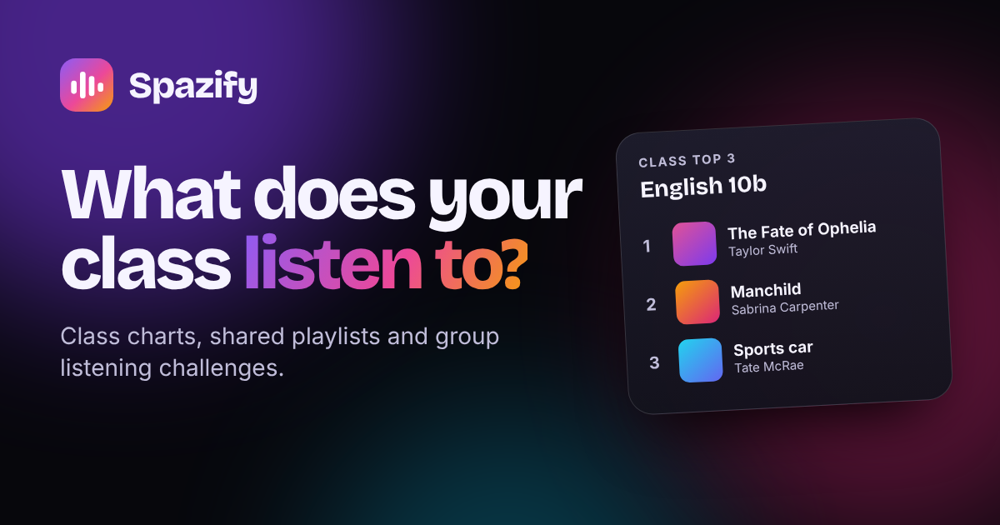

# Spazify 🎧

**Your class. Your soundtrack.** Spazify shows what a school class is listening to:
live class charts, shared playlists and group listening challenges.

Everybody can join with **Spotify**, **Apple Music** or **Amazon Music** – or completely
**privately**, without any music account, by simply adding the songs they love.



## Features

- **Class charts** – the most popular songs, artists and genres of the class, with ▲▼ movers and NEW entries.
- **Shared playlists** – classmates pick which of their playlists the class may see, or build *mixtapes* together right in the app. Every class also gets an automatic **Class Mix**.
- **Group challenges** – e.g. “listen to 50 hours of music together”, “collect 30 favourite songs”, “discover 25 artists”, “get 20 classmates on board”. Anybody can create new ones.
- **Join your way** – Spotify login (automatic top songs, recent plays and playlists), Apple Music (optional, see below), Amazon Music or private mode (pick songs by hand – no account, nothing tracked).
- **30-second previews** for every song, plus “listen on Spotify / Apple Music / Amazon Music / YouTube Music” links.
- **Notes in English** – classmates explain why they love a song (“Fresh picks” on the dashboard).
- **Class Recap** – a full-screen story about the class (great for presenting it in class!).
- **Demo class** with 25 made-up classmates – works instantly, without any setup.
- **Privacy first** – nicknames, emoji avatars, “share my listening time” switch, download & delete your data any time. Fonts and icons are hosted on the site itself (no Google requests).
- Works great on phones (bottom navigation, add to home screen) and on the projector (QR code to join).

## Put it online with Netlify (about 5 minutes)

1. Push this repository to GitHub (it already is, if you are reading this on GitHub).
2. Log in at [app.netlify.com](https://app.netlify.com) → **Add new site** → **Import an existing project** → **GitHub** → choose this repository.
3. Netlify reads all settings from `netlify.toml` – just click **Deploy**.
4. Open your new site (e.g. `https://your-name.netlify.app`). The demo class works right away.
   Go to **Site setup** (link in the footer) to check that the server functions are connected.

> ⚠️ Please use **Import from Git**, not drag & drop. Drag & drop uploads don't include the
> server function, so classes would only be saved on one device (the site still works
> in a “this device only” mode).

Netlify stores the class data in **Netlify Blobs** – there is nothing else to set up.
If *Site setup* says the server functions are not available right after the very first deploy,
simply trigger a new deploy (**Deploys → Trigger deploy → Deploy site**).

## Spotify login (recommended)

1. Go to the [Spotify Developer Dashboard](https://developer.spotify.com/dashboard) and **create an app** (choose “Web API”).
2. Add a **Redirect URI**: your site address **with a slash at the end**, e.g. `https://your-name.netlify.app/`
   (the *Site setup* page shows the exact address and has a copy button).
3. Copy the app’s **Client ID**.
4. In Netlify: **Site configuration → Environment variables → Add a variable**
   `SPOTIFY_CLIENT_ID` = your Client ID. Then **Deploys → Trigger deploy**.
5. In the Spotify dashboard, open **User Management** and add the people who want to log in with Spotify (name + email of their Spotify account).

Good to know (Spotify rules since 2026): while an app is in *Development Mode*, only **5 people** can log in
with it, and the owner of the app needs **Spotify Premium**. Everybody else simply joins privately or with
Apple/Amazon Music – they still count in the charts and challenges. The login never sends a password to
Spazify (it uses the secure PKCE flow), and the Spotify key stays in the user’s browser.

## Apple Music (optional)

Apple’s MusicKit needs a paid Apple Developer Program membership. If you have one:

1. Create a **MusicKit** key in your Apple Developer account and download the `.p8` file.
2. Add these Netlify environment variables, then redeploy:
   - `APPLE_TEAM_ID` – your team ID
   - `APPLE_KEY_ID` – the key ID
   - `APPLE_PRIVATE_KEY` – the full content of the `.p8` file

Without it, Apple Music users just pick their favourite songs by hand.

## Amazon Music

Amazon’s Music API is invite-only, so “Continue with Amazon Music” lets people pick their favourite songs
by hand (with the Amazon Music badge on their profile).

## How the charts work

| What | Points |
| --- | --- |
| A classmate’s #1 top song (Spotify / Apple Music) | 30 (then 29, 28 … down to 1) |
| Every recent play | +2 (max. 10 plays per person) |
| A song added by hand | +20 |
| Every heart from a classmate | +5 |

The same song from different apps counts as **one** song (e.g. “Blinding Lights – 2020 Remaster” = “Blinding Lights”).

## Run it on your computer

You need [Node.js](https://nodejs.org) 22 or newer.

```bash
npm install
npm run dev
```

Then open <http://127.0.0.1:8888>. To try the Spotify login locally, create a file called `.env` with
`SPOTIFY_CLIENT_ID=...` and add `http://127.0.0.1:8888/` as an extra Redirect URI in the Spotify dashboard.

Run the tests with:

```bash
npm test
```

## Project structure

```
public/                 the website (plain HTML, CSS and JavaScript - no build step)
  index.html
  css/app.css           design system (dark theme, glass cards, animations)
  js/main.js            start, router, layout, global buttons
  js/store.js           app state and all actions (add song, like, log time …)
  js/config.js          app name and settings  ← change the name here
  js/views/             the pages (landing, join, home, charts, playlists, …)
  js/ui/                components, dialogs, toasts
  js/lib/               charts maths, demo class, Spotify, Apple Music, search …
netlify/functions/api.mjs   the server function (all /api/* requests)
server/                 API logic (also used by the local dev server)
scripts/dev.mjs         local development server
test/                   automated tests
```

## Change the name

The name appears in `public/js/config.js` (`appName`), `public/index.html` (title and meta tags)
and `public/manifest.webmanifest`.

## Credits

Fonts: [Inter](https://rsms.me/inter/) and [Bricolage Grotesque](https://github.com/ateliertriay/bricolage) (SIL Open Font License) ·
Icons: [Lucide](https://lucide.dev) (ISC) and [Simple Icons](https://simpleicons.org) (CC0) ·
QR codes: [qrcode-generator](https://github.com/kazuhikoarase/qrcode-generator) (MIT) ·
Song search, covers and previews: Apple’s public iTunes Search API.
Spotify, Apple Music and Amazon Music are trademarks of their owners; this school project is not affiliated with them.
